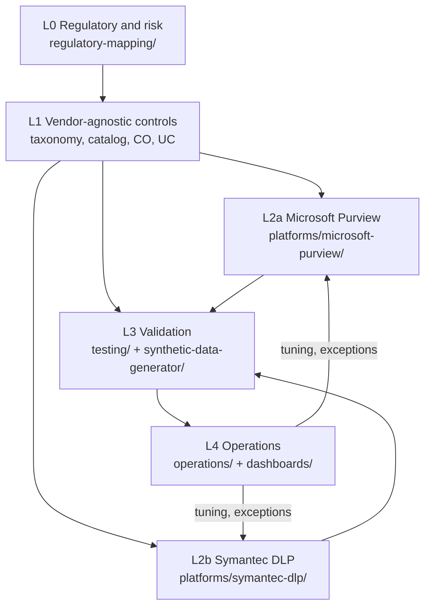

# Architecture

## Layers



The rule: **L1 never references a vendor feature.** A use case says "block external email containing 5 or more CH/LU IBANs with customer context". Only L2 says "Purview SIT International banking account number (IBAN), minCount 5, AccessScope NotInOrganization".

## Control objectives

| ID | Control objective |
|---|---|
| CO-01 | Banking data is classified and labelled according to the approved taxonomy |
| CO-02 | Restricted and Highly Restricted data is not sent by email to unauthorised external recipients |
| CO-03 | Collaboration platforms (SharePoint, OneDrive, Teams) do not expose Restricted data to unauthorised external parties |
| CO-04 | Endpoint egress (USB, print, clipboard, browser upload, network share, unallowed apps) of Restricted data is controlled |
| CO-05 | Client data is not disclosed to unsanctioned cloud services or public generative AI tools |
| CO-06 | AML investigation information is protected against tipping-off |
| CO-07 | Cross-border and intra-group transfers of client data follow approved jurisdictional rules |
| CO-08 | DLP events are detected, triaged, evidenced and closed; exceptions are approved, time-bound and reviewed |

## Traceability model

| From | To | Where the link lives |
|---|---|---|
| RM-xx (regulatory mapping row) | CO-xx | `regulatory-mapping/mapping.csv` |
| CO-xx | UC-xxx | `use-cases/catalog.csv` |
| UC-xxx | PV-POL-xxx / SY-POL-xxx | policy spec `use_cases:` field |
| PV-POL-xxx | TC-xxx | `testing/test-matrix.csv` |
| TC-xxx | SCN-xxx + file hash | test case `test_data:` field, `output/manifest.json` |
| TC-xxx result | Evidence ID | test matrix `evidence_ref` |

## Repository tree

```text
.
├── README.md, SECURITY.md, CONTRIBUTING.md, CHANGELOG.md, LICENSE
├── .github/                    CI, Dependabot, labels, issue forms, PR checklist
├── docs/                       Positioning, architecture, limits, lab setup, conventions, roadmap
├── data-classification/        taxonomy.yaml (5 levels), data-catalog.csv (DC-01..DC-21)
├── use-cases/                  catalog.csv (UC-001..UC-015), detailed sheets UC-xxx.yaml
├── platforms/
│   ├── microsoft-purview/      README (architecture, licensing, rollout), policies/, custom-sits/, scripts/
│   └── symantec-dlp/           README (design, components), policy-design/
├── comparison/                 purview-vs-symantec.csv
├── testing/                    test-strategy.md, test-matrix.csv, test-cases/
├── synthetic-data-generator/   dlpgen Python package, config, tests
├── automation/                 GitHub bootstrap (labels, milestones, issues from backlog)
├── operations/                 lifecycle and RACI, triage playbook, exception management
├── dashboards/                 KPI/KRI definitions
├── regulatory-mapping/         methodology.md, mapping.csv
├── templates/                  use case, policy, test case, exception request
└── backlog/                    initial-backlog.csv (28 issues)
```

| Folder | Purpose | Key files |
|---|---|---|
| `data-classification/` | Single source of truth for levels and data categories | `taxonomy.yaml`, `data-catalog.csv` |
| `use-cases/` | Vendor-independent risk scenarios with detection intent, thresholds and acceptance criteria | `catalog.csv`, `UC-001.yaml` |
| `platforms/microsoft-purview/` | Purview-specific implementation and lab scripts | `policies/PV-POL-00x.yaml`, `custom-sits/*.xml`, `scripts/*.ps1` |
| `platforms/symantec-dlp/` | Translation of the same use cases to Symantec DLP concepts | `README.md`, `policy-design/SY-POL-001.yaml` |
| `testing/` | How tests are designed, run and recorded | `test-strategy.md`, `test-matrix.csv` |
| `synthetic-data-generator/` | Reproducible synthetic corpus with manifest and hashes | `dlpgen/`, `config.example.yaml` |
| `operations/` | Run model: lifecycle, triage, exceptions | `*.md`, `exceptions-register.csv` |
| `dashboards/` | Indicator definitions, not individual scoring | `kpi-kri.md` |
| `regulatory-mapping/` | Requirement vs control separation | `methodology.md`, `mapping.csv` |
